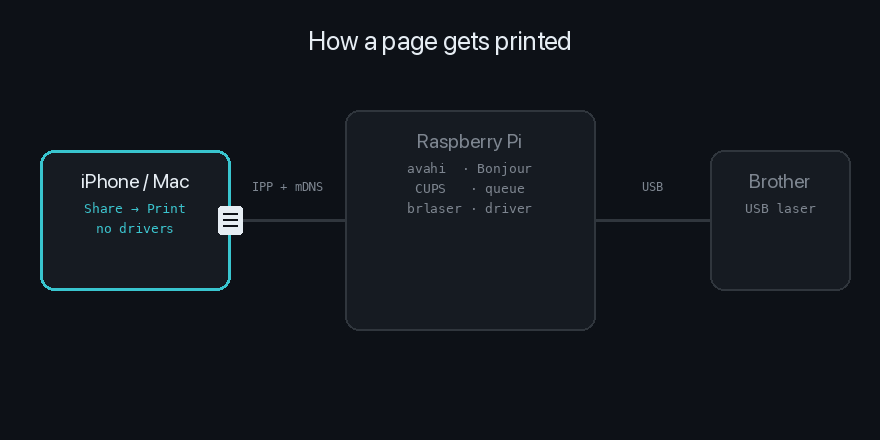
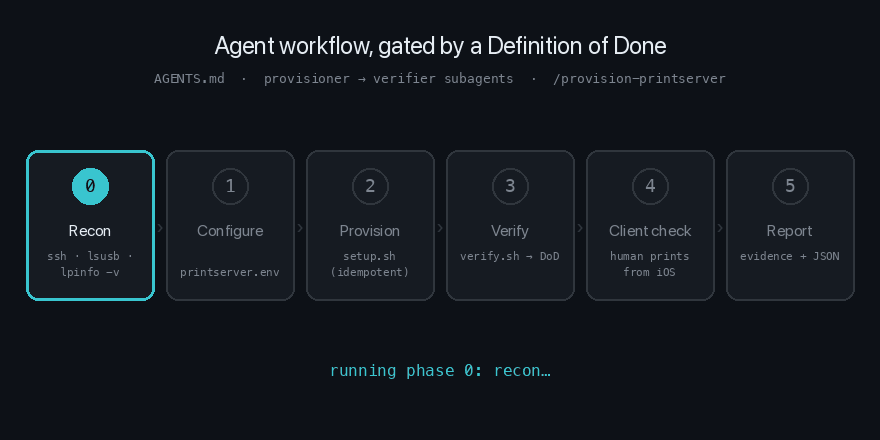
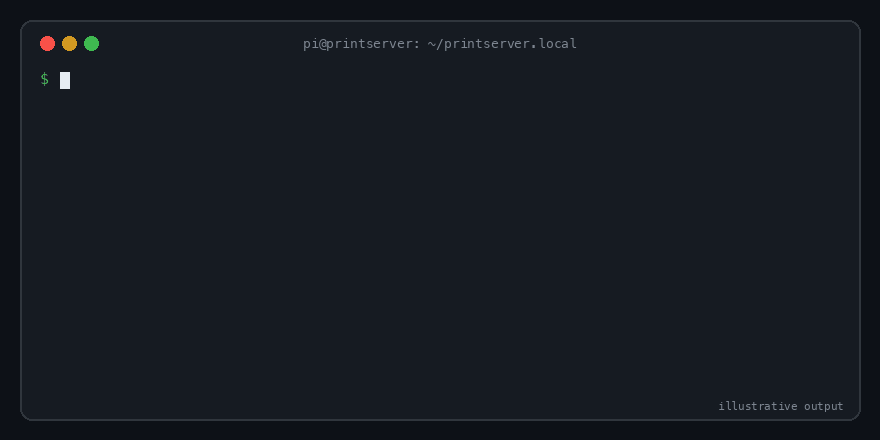

<div align="center">

# 🖨️ printserver.local

**Turn a Raspberry Pi into an AirPrint server for a USB Brother printer.**<br>
Print from iPhone, iPad and Mac with no drivers, no cloud, and no vendor app.

[](https://github.com/konraddzbik/printserver.local/actions/workflows/lint.yml)




</div>

Tested with: **Raspberry Pi 3 Model B**, **Raspberry Pi OS Lite (64-bit)**, **Brother HL-1110** (USB), CUPS 2.4.x.

---

## ⚡ Three ways to set it up

| | Path | Best for | Time |
|---|---|---|---|
| 🤖 | [**Let an agent do it**](#-agentic-setup) | Claude Code, Codex, Cursor, … with SSH access to the Pi | ~5 min |
| 🧰 | [**Run the scripts**](#-scripted-setup) | You, on the Pi, two commands | ~5 min |
| 📖 | [**Follow the manual guide**](#how-it-works) | Learning what each piece does | ~20 min |

All three end at the same place: the [**Definition of Done**](docs/DEFINITION_OF_DONE.md).

### 🤖 Agentic setup

This repo ships with instructions for coding agents. [`AGENTS.md`](AGENTS.md) gives any agent a phased workflow with an exit gate after each phase, plus guardrails and a measurable Definition of Done. It isn't allowed to say "done" until `verify.sh` passes and you've confirmed a page printed from your phone.

<div align="center">

</div>

With **Claude Code**, from a clone of this repo on your Mac:

```text
/provision-printserver pi@printserver.local
```

The skill orchestrates two subagents. Only the skill declares DONE, after you confirm a page printed from your phone:

| Subagent | Role | Can change the Pi? |
|---|---|---|
| [`printserver-provisioner`](.claude/agents/printserver-provisioner.md) | Recon → configure → `setup.sh` | ✅ (risky commands and script changes are returned for your approval first) |
| [`printserver-verifier`](.claude/agents/printserver-verifier.md) | Runs `verify.sh` once and reports `AUTOMATED: PASS / FAIL` | ❌ read-only, enforced by a [hook](.claude/hooks/verifier-readonly.sh) |

With **any other agent**, tell it: *"Follow AGENTS.md to provision the print server at pi@printserver.local."*

### 🧰 Scripted setup

On the Pi:

```bash
sudo apt install -y git                                    # Pi OS Lite doesn't ship git
git clone https://github.com/konraddzbik/printserver.local.git && cd printserver.local
cp config/printserver.env.example config/printserver.env   # optional: uncomment what you change
chmod 600 config/printserver.env
sudo ./scripts/setup.sh --dry-run                          # preview, changes nothing
sudo ./scripts/setup.sh                                    # converges; re-runs only change what differs
./scripts/verify.sh                                        # executable Definition of Done
```

<div align="center">

</div>

`verify.sh --json` emits machine-readable results for agents and CI. `PRINT_TEST_PAGE=1 ./scripts/verify.sh` adds a real test print (DOD-11). It's deliberately not settable from the config file.

Secure by default: CUPS is reachable from the local network only (`NETWORK_ACCESS=local`), and the admin pages stay on the Pi (`REMOTE_ADMIN=no`). AirPrint needs neither. An existing queue keeps its driver options on re-runs unless you pass `--force`.

### ✅ Definition of Done

| | Check |
|---|---|
| DOD-1…2 | `cups` and `avahi-daemon` active |
| DOD-3…4 | CUPS listens on the LAN, web UI enabled on `:631` |
| DOD-5…8 | Queue enabled, accepting, **shared**, default |
| DOD-9…10 | **This Pi** advertises the queue over Bonjour with an AirPrint (`URF=`) TXT record |
| DOD-11 | *(opt-in)* Test page completes |
| DOD-M1…M3 | DHCP reservation · prints from an Apple device · no secrets committed |

Full table with fixes: [`docs/DEFINITION_OF_DONE.md`](docs/DEFINITION_OF_DONE.md).

---

# 📖 Manual guide

## How it works

```
iPhone / iPad / Mac
        │  (AirPrint = IPP + Bonjour/mDNS)
        ▼
Raspberry Pi
 ├── avahi-daemon  → broadcasts the shared printer via Bonjour
 ├── CUPS          → print server, queue, filters
 └── brlaser       → open-source driver for host-based Brother printers
        │  (USB)
        ▼
Brother printer
```

Modern CUPS (2.x) advertises **shared** queues via DNS-SD automatically. No `airprint-generate`, no manual Avahi service files — those guides are outdated.

---

## 1. Flash the OS (headless)

Use [Raspberry Pi Imager](https://www.raspberrypi.com/software/):

1. **Choose OS** → *Raspberry Pi OS (other)* → **Raspberry Pi OS Lite (64-bit)** — no desktop needed for a print server, and the Pi 3's 1 GB RAM will thank you.
2. Open the **settings (gear icon)** before writing and set:
   - hostname (e.g. `printserver`)
   - enable SSH
   - username + password
   - Wi-Fi SSID, password, **and country code**
3. Write the card, boot the Pi, wait 2–3 minutes on first boot.

```bash
ssh <user>@printserver.local
```

> **Headless troubleshooting ("host unavailable"):**
> - First boot takes 2–3 min (filesystem resize) — be patient.
> - `.local` not resolving → find the IP in your router's DHCP list, or `arp -a` from your Mac.
> - Pi 3 is **2.4 GHz only**. A 5 GHz-only SSID (or aggressive band steering) means the Pi never joins.
> - Verify the Imager settings saved: the `bootfs` partition should contain `firstrun.sh` / `custom.toml`.
> - Fastest diagnostic: plug in Ethernet. If it appears, it's a Wi-Fi config problem.

Give the Pi a **static IP or DHCP reservation** — a print server that changes address is a print server that "randomly stops working".

## 2. Install CUPS, Avahi, and the Brother driver

```bash
sudo apt update
sudo apt install cups avahi-daemon printer-driver-brlaser
sudo usermod -aG lpadmin $USER
```

`brlaser` is the open-source driver covering most host-based Brother lasers (HL-1110, HL-L2300 series, DCP-1510/7030/7040, and more). If your Brother supports **IPP Everywhere / AirPrint natively** (most network models after ~2013), you won't need it — see step 4.

## 3. Open CUPS to the network

CUPS ships locked to localhost. Enable everything in **one** command — separate `cupsctl` invocations can silently reset earlier flags (I learned this the fun way when the web UI reported *"The web interface is currently disabled"*):

```bash
sudo cupsctl --no-remote-any --remote-admin --share-printers WebInterface=yes
sudo systemctl restart cups
```

Verify it actually listens on the network:

```bash
sudo ss -tlnp | grep 631
```

You want `*:631` or `0.0.0.0:631`. If you only see `127.0.0.1:631`, the config didn't take.

> **Security note:** `--no-remote-any` keeps CUPS to the local subnet (`Allow @LOCAL`). `--remote-any` would open it to any network the Pi can see, including over a global IPv6 address, so NAT alone doesn't protect you. `--remote-admin` is only here so you can add the printer from your Mac's browser in step 4. Once that's done, turn it off with `sudo cupsctl --no-remote-admin --no-remote-any --share-printers WebInterface=yes` (the scripts never enable it unless you set `REMOTE_ADMIN=yes`).

## 4. Add the printer

### Option A — web UI

1. Go to `https://<pi-ip>:631` (accept the self-signed cert warning; `http://` returns *426 Upgrade Required*).
2. **Administration → Add Printer** — log in with your SSH user (must be in `lpadmin`).
3. Your USB printer should be listed under *Local Printers*, e.g.
   `Brother HL-1110 series (Brother HL-1110 series)`.
4. Name it (no spaces or `/` `#`), and — **critical — check "Share This Printer"**. Unshared printers are invisible to AirPrint.
5. Pick the driver:
   - Host-based models (HL-1110 etc.): **Brother HL-1110 series, using brlaser**
   - Modern IPP-capable printers: **IPP Everywhere** (driverless — prefer this when available)
6. Set defaults (A4, duplex if applicable) and finish.

### Option B — command line

```bash
lpinfo -v                      # list detected device URIs
sudo lpadmin -p Brother -E \
  -v "usb://Brother/HL-1110%20series?serial=XXXXXXX" \
  -m drv:///brlaser.drv/br1110.ppd \
  -o printer-is-shared=true
sudo lpadmin -d Brother        # set as default
```

For driverless printers, replace `-m drv:///...` with `-m everywhere`.

> If the web UI's Add Printer page skips straight to a manual *Connection:* URI field (sometimes with garbage pre-filled), CUPS detected nothing. Check `lpinfo -v` and `lsusb` — printer off, sleeping, or a bad cable are the usual suspects.

## 5. Verify

```bash
# Services up?
systemctl status cups avahi-daemon

# Queue healthy?
lpstat -t                      # want: "printer Brother is idle. enabled"

# AirPrint actually broadcast?
avahi-browse -rt _ipp._tcp     # your printer must appear here

# Test print from the Pi
echo "Hello from CUPS" | lp -d Brother
```

Then grab your iPhone → any app → Share → Print. The printer appears within seconds as `Brother @ printserver`.

> 💡 `./scripts/verify.sh` runs all of these checks, and a few more, in one go. See the [Definition of Done](docs/DEFINITION_OF_DONE.md).

## Troubleshooting

| Symptom | Cause / fix |
|---|---|
| iOS doesn't list the printer | Printer not **shared**; or client (AP) isolation on Wi-Fi blocks mDNS — common on guest networks and some mesh setups |
| Printer listed but jobs fail | Wrong driver; for Brother host-based models use `brlaser`, not the generic PCL ones |
| Worked yesterday, gone today | Pi got a new IP — set a DHCP reservation; or restart `avahi-daemon` |
| `lpstat` shows `disabled`/`paused` | `sudo cupsenable Brother && sudo cupsaccept Brother` |
| Web UI: "Web interface is currently disabled" | `sudo cupsctl WebInterface=yes && sudo systemctl restart cups` |
| 403 on Administration pages | Missing `--remote-admin`, or user not in `lpadmin` |
| Nothing in `lpinfo -v` | Check `lsusb`; wake the printer; try another cable/port |

## Optional hardening & maintenance

```bash
# Keep job history bounded (1 h) instead of piling up; 'no' would break verify.sh DOD-11
sudo cupsctl PreserveJobHistory=3600

# Unattended security updates
sudo apt install unattended-upgrades
```

CUPS logs live in `/var/log/cups/error_log` — bump `LogLevel debug` in `cupsd.conf` when debugging, and turn it back off after (SD cards don't love verbose logging).

## Repository layout

```
.
├── AGENTS.md                  # operational contract for coding agents (phases, gates, guardrails)
├── CLAUDE.md                  # Claude Code entry point → imports AGENTS.md
├── .claude/
│   ├── agents/                # printserver-provisioner, printserver-verifier
│   ├── hooks/                 # verifier-readonly.sh (enforces read-only verifier)
│   └── skills/provision-printserver/   # /provision-printserver
├── config/printserver.env.example
├── docs/DEFINITION_OF_DONE.md
├── scripts/
│   ├── lib.sh                 # shared, validated config loader
│   ├── setup.sh               # converging provisioning (--dry-run, --force)
│   ├── verify.sh              # executable DoD (--json), source of truth for the checks
│   └── check-dod-sync.sh      # CI: verify.sh ⇄ DEFINITION_OF_DONE.md
└── assets/                    # README GIFs; regenerate: python3 assets/src/make_gifs.py
```

> The scripts and the manual share the same network default (`Allow @LOCAL`). The scripts also keep remote admin off. Opt in with `REMOTE_ADMIN=yes` in `config/printserver.env`.

## Contributing

PRs welcome. Keep scripts `shellcheck`-clean and convergent (re-runs change nothing). If you add a check, add it to `verify.sh` and `docs/DEFINITION_OF_DONE.md` (CI enforces the match), update the DoD summary above, then regenerate the GIFs. See [`AGENTS.md` → Changing this repo](AGENTS.md#changing-this-repo).

## License

MIT — use, share, adapt.
